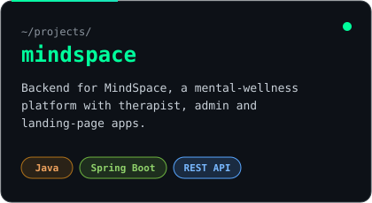
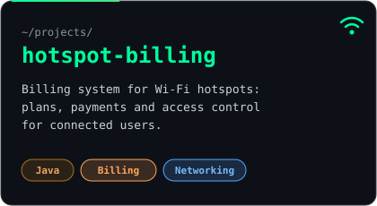
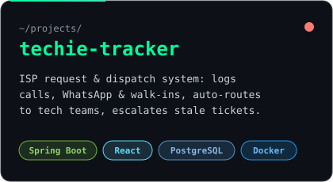

<!-- Hero: self-hosted animated terminal (assets/hero.svg) -->
<p align="center">
  
</p>

<p align="center">
  <a href="https://www.linkedin.com/in/kelvinkiumbe"></a>
  <a href="https://x.com/greatkiumbes"></a>
  
  <a href="https://github.com/kelvinkiumbe1?tab=followers"></a>
</p>

<br/>

## 🛰️ `~/about`

I build the part of the app you never see, and I care about keeping it **fast**, **reliable** and **hard to break into**.

- ⚙️ Backend services & REST APIs with **Java + Spring Boot** on **PostgreSQL**
- 🛡️ Security-minded: learning offensive tools so I can build better defenses
- 🐳 Leveling up in **DevOps**: Docker → Kubernetes → automated CI/CD
- 📱 Comfortable across the stack with **React Native** and the web
- 🤝 Open to collaborating on **backend**, **security** & **open-source** work

```yaml
motto: "Build it. Secure it. Ship it."
```

## 🚀 `~/projects`

<p align="center">
  <a href="https://github.com/kelvinkiumbe1/mindspace"></a>
  <a href="https://github.com/kelvinkiumbe1/hotspot-billing"></a>
  <a href="https://github.com/kelvinkiumbe1/techie"></a>
</p>

## 🧰 `~/arsenal`

<table align="center">
  <tr>
    <th>⚙️ Backend</th>
    <th>🗄️ Data</th>
    <th>🎨 Frontend & Mobile</th>
    <th>🐧 Systems</th>
  </tr>
  <tr>
    <td align="center"></td>
    <td align="center"></td>
    <td align="center"></td>
    <td align="center"></td>
  </tr>
</table>

<details open>
<summary><b>🚧 Currently loading…</b></summary>
<br/>

| Track | Tools | Status |
|---|---|---|
| 🐳 Containers |  Docker | `████████░░░░` learning |
| ☸️ Orchestration |  Kubernetes | `█████░░░░░░░` learning |
| 🔁 CI/CD |  GitHub Actions | `██████░░░░░░` learning |
| 🛡️ Security |  Kali · Nmap · Wireshark · Burp Suite | `████░░░░░░░░` learning |

</details>

## 📡 `~/telemetry`

<p align="center">
  
  
</p>
<p align="center">
  
</p>

<!-- 3D contribution calendar, regenerated every 12h by .github/workflows/profile-art.yml -->
<p align="center">
  
</p>

<details>
<summary><b>⚡ Live activity log</b></summary>
<br/>

<!--START_SECTION:activity-->
1. 🎉 Merged PR [#5](https://github.com/kelvinkiumbe1/badges-demo/pull/5) in [kelvinkiumbe1/badges-demo](https://github.com/kelvinkiumbe1/badges-demo)
2. 🎉 Merged PR [#6](https://github.com/kelvinkiumbe1/badges-demo/pull/6) in [kelvinkiumbe1/badges-demo](https://github.com/kelvinkiumbe1/badges-demo)
3. 🎉 Merged PR [#14](https://github.com/kelvinkiumbe1/badges-demo/pull/14) in [kelvinkiumbe1/badges-demo](https://github.com/kelvinkiumbe1/badges-demo)
4. 🎉 Merged PR [#10](https://github.com/kelvinkiumbe1/badges-demo/pull/10) in [kelvinkiumbe1/badges-demo](https://github.com/kelvinkiumbe1/badges-demo)
5. 🎉 Merged PR [#1](https://github.com/kelvinkiumbe1/badges-demo/pull/1) in [kelvinkiumbe1/badges-demo](https://github.com/kelvinkiumbe1/badges-demo)
6. 🎉 Merged PR [#18](https://github.com/kelvinkiumbe1/badges-demo/pull/18) in [kelvinkiumbe1/badges-demo](https://github.com/kelvinkiumbe1/badges-demo)
<!--END_SECTION:activity-->

</details>

<br/>

<p align="center">
  <picture>
    <source media="(prefers-color-scheme: dark)" srcset="https://raw.githubusercontent.com/kelvinkiumbe1/kelvinkiumbe1/output/github-snake-dark.svg" />
    <source media="(prefers-color-scheme: light)" srcset="https://raw.githubusercontent.com/kelvinkiumbe1/kelvinkiumbe1/output/github-snake.svg" />
    
  </picture>
</p>

<p align="center"><code>kelvin@sec:~$ exit</code> · <i>connection closed. thanks for stopping by 👾</i></p>
